# Обновление существующего notebook на Unraid

Это подготовленный механизм с ручным финальным Apply в штатном Unraid WebGUI.
Он не подключён к production. Создавать/удалять/пересоздавать контейнеры, менять env или
применять миграции в рамках подготовки запрещено. Команды ниже — инструкция для будущего,
отдельно разрешённого maintenance window, а не команды, выполненные при разработке.

## Границы и архитектура

```mermaid
flowchart LR
  B[Существующий Docker CI: проверки и GHCR digest] --> M[image.json: SHA и migration hashes]
  M --> P[Unraid: backup и restore verification]
  P --> R[Локальный review и upgrade/rollback rehearsal]
  R --> A[GitHub Environment: ручное approval]
  A --> I[approved intent artifact]
  I --> V[Unraid: исходящий HTTPS и проверка approval]
  V --> G[Оператор: существующий шаблон Unraid, только Repository]
  G --> H[Сверка конфигурации, digest и readiness]
```



Cloud runner — только GitHub-hosted `ubuntu-latest`, без маршрута к LAN, SSH, Docker API
или production secrets. Он выдаёт разрешение на пару previous/candidate digests и hash локального
review. Сам Unraid забирает metadata исходящим HTTPS к GitHub. Постоянного poller, root runner,
открытого Docker socket или входящего deploy endpoint нет. Локальный Python helper — доверенный
административный инструмент; доступ к локальному Docker фактически равен root. Он запускается
оператором, а не выполняет произвольные команды из GitHub artifacts.

**Сохранить container ID при смене образа невозможно.** Обновление через Unraid сохраняет
пользовательскую конфигурацию и persistent mappings, но создаёт новый container ID. Если под
«не удалять контейнер» подразумевается запрет даже на будущее штатное пересоздание, image update
невозможен: ограничиться preflight/backup/review. Этот helper намеренно не реализует apply,
`docker run/create/rm`, stop/start, удаление данных или production restore. Финальная интеграция
Unraid требует его версии, реального пользовательского XML и согласования семантики обновления.

## Единственная допустимая конфигурация этой установки

| Параметр | Значение |
| --- | --- |
| Имя | `notebook` |
| Registry | `ghcr.io/imnoname25/notebook` |
| Network | `notebook-net` |
| Port | host `3100` → container `3000/tcp` |
| Uploads | `/mnt/user/appdata/note/uploads` → `/data/uploads`, rw |
| Backups | `/mnt/user/appdata/note/backup` → `/data/backups`, rw |
| APP_ORIGIN | `http://192.168.110.11:3100` |
| TZ | `Asia/Yekaterinburg` |
| PUID / PGID / UMASK | `99` / `100` / `002` |

Repository XML в `unraid/notebook.xml` — generic template для новых установок с другими
defaults; его нельзя накатывать поверх этой установки. Helper читает именно существующий
пользовательский template с Unraid, сравнивает его с действующим контейнером и создаёт только
приватные comparison copies. Оригинальный template он не записывает. `DATABASE_URL` и
`SETTINGS_ENCRYPTION_KEY` не передаются в CI и не меняются. Effective HostConfig, все mounts
и значения этих секретов сравниваются приватным fingerprint; raw inspect/Env не сохраняются.

## Что ещё неизвестно — это блокирует подключение

- Версия Unraid, архитектура, путь к реально используемому пользовательскому XML и его формат.
- Имя, image/version, actual persistent mount, socket directory PostgreSQL; имя database и
  существующая роль для backup. Пароли/connection strings в чат не нужны.
- Доступность `pg_dump`, `pg_restore`, `psql`, возможность локальной socket-аутентификации
  без интерактивного пароля. Не угадывать роль из generic PostgreSQL template.
- Отдельная подтверждённая пустая verification DB: имя контейнера, database/role/socket,
  image той же major версии, network mode `none`, storage без пересечений с production.
- Кто ещё пишет в Notebook DB/uploads, допустимое maintenance window и свободное место.
- Наличие Python 3.11+ на Unraid, способ его поддерживаемой установки, User Scripts/других
  плагинов и разрешённый локальный механизм запуска. Python не входит в наши предположения
  о стандартной установке Unraid: сначала подтвердить его наличие; helper не устанавливает его.
- Доступность GitHub Environment required reviewers для тарифа/видимости репозитория,
  состав reviewers и допустимость будущего штатного пересоздания container ID.

Пока эти данные не получены, `deployment.example.json` содержит `null`: preflight завершится
ошибкой, а deployment approval workflow отключён отсутствующей Repository Variable.

## Первоначальная настройка на Unraid

1. После подтверждения prerequisites разместить проверенные файлы `deploy.py`, `deploy_core.py`,
   `approval.py` в выбранном persistent административном каталоге, принадлежащем root и не
   доступном на запись Notebook (`99:100`). Не исполнять скрипты из uploads/backups и не обновлять
   их автоматически из входящей заявки. Все три файла должны быть одной проверенной версии.
2. Скопировать `deployment.example.json` в приватный локальный config вне репозитория,
   заполнить только полученные от администратора параметры. `template_path` — существующий
   пользовательский XML, а не repository template. Никаких паролей/URL в config нет.
   Роль/БД ограничены простыми identifiers; socket должен быть абсолютным локальным путём.
   Config пример не выбирает PostgreSQL major автоматически.
3. Подготовить отдельно verification контейнер и пустую БД утверждённым администратором способом.
   Helper сам контейнеров/БД не создаёт и не удаляет. Он отвергает production container,
   network mode кроме `none`, privileged mode, пересечения mounts, неподходящую major версию и
   непустую БД. После пробного restore БД больше не пустая: следующий прогон требует новой
   отдельно подготовленной пустой БД; helper никогда не делает `--clean`.
4. Проверить local PostgreSQL socket auth выбранными ролями. Helper использует `--no-password`,
   не принимает пароль в argv/JSON и не копирует production credentials. Если auth требует
   секрета, администратор настраивает существующий поддерживаемый локальный механизм внутри
   соответствующего контейнера; никаких изменений `DATABASE_URL` для этого не делается.
5. На время обновления отключить внешние auto-update/backup jobs для Notebook и обеспечить
   отсутствие других writers в его DB/uploads. Не менять владельца PostgreSQL directory.
6. Выполнить только read-only проверку:

   ```bash
   python3 /PATH/TO/TRUSTED/deploy.py --config /PATH/TO/PRIVATE/config.json preflight
   ```

   В выводе только подтверждение конфигурации и доступные image digests. При неизвестной major
   версии, unsupported XML или конфигурационном drift исправить/согласовать причину до backup.

### GitHub Environment, Secrets и Variables

Создать **Settings → Environments → production-unraid** до включения workflow. Добавить
как минимум одного индивидуального Required Reviewer (team-only пока не поддерживается).
Ограничить deployment branch `main`; запретить admin bypass. При двух независимых операторах
включить Prevent self-review. Проверка helper не предполагает несуществующего REST-поля для
admin bypass: она проверяет фактическую approval history и identity reviewer. Для private
репозитория заранее проверить поддержку required reviewers текущим GitHub планом.

| Где | Имя | Назначение |
| --- | --- | --- |
| Repository Actions Variable | `UNRAID_APPROVAL_ENABLED=true` | Включить только после настройки Environment и локального rehearsal; по умолчанию job skipped |
| Автоматический GitHub token | `GITHUB_TOKEN` (`github.token`) | Только `contents: read`, `actions: read`; вручную Secret не создавать |
| GitHub Environment Secrets | **Не нужны** | Здесь нет SSH, DB credentials, encryption key или root runner token |
| Только Unraid, опциональный private file | read-only GitHub token | Для Actions artifacts/API; fine-grained repo Actions: read, Contents: read; mode 0600, путь через `--token-file` |
| Только Unraid, если GHCR private | read-only `read:packages` credential | Настроить штатную registry auth Unraid; не копировать Docker auth в CI artifacts |

Скачивание artifacts может требовать GitHub authentication даже у публичного репозитория.
Токен хранить только локально в защищённом административном каталоге, вне Git, stdout и backup
metadata. Скрипт читает token file в память; заголовок Authorization не пересылается blob-host.
В `.env.example` перечислены только справочные имена новых настроек: runtime env приложения
не добавляются. Не вводить `DATABASE_URL`, `SETTINGS_ENCRYPTION_KEY` или SQL dumps в GitHub.

## Обновление: будущая процедура после отдельного разрешения

1. Создать обычный stable release отдельно существующим механизмом. Дождаться успешных
   Docker **и Android** workflow. Docker publish дополнительно выдаёт artifact
   `notebook-image-<SHA>/image.json`: immutable digest, commit SHA, ref, version и hashes SQL.
   Этот artifact появляется только после существующих CI gates и GHCR publish; он не содержит
   credentials, dumps, XML или пользовательских данных. Старые runs без metadata не подходят:
   нужен новый проверенный stable build, а не вручную придуманное соответствие digest → SHA.
2. Скачать ровно `image.json` из выбранного успешного Docker run на Unraid. Сохранить bytes без
   переформатирования. Зафиксировать предыдущий immutable digest из `preflight`; не угадывать
   его по актуальному registry latest. Не делать image prune до завершения периода наблюдения.
3. Открыть согласованное maintenance window; штатно остановить только `notebook` в Unraid GUI.
   PostgreSQL оставить работающим. `FIX_PERMISSIONS` должен быть выключен: рекурсивный repair
   при старте изменит владельца приватных deployment backups. Helper отвергает включённый repair.
   Убедиться, что Notebook — единственный writer, отключены
   любые внешние writers/jobs. Это операторское условие: helper не может доказать отсутствие
   будущего внешнего подключения к БД. Флаг ниже — его явное подтверждение.
4. Подготовить snapshot и проверить restore:

   ```bash
   python3 /PATH/TO/TRUSTED/deploy.py --config /PATH/TO/PRIVATE/config.json prepare \
     --manifest /PATH/TO/image.json \
     --previous-image 'ghcr.io/imnoname25/notebook@sha256:PREVIOUS_64_HEX' \
     --exclusive-maintenance
   ```

   Результаты — только в `/mnt/user/appdata/note/backup/deployments/<PREPARATION_ID>/`, mode
   directory 0700/files 0600. Внутри находятся custom-format `database.dump`, `uploads.tar.gz`,
   hashes, приватный original XML и state. SQL dump содержит auth-данные: это operational DR
   backup, не обычный application export. Не раздавать его через SMB, CI или публичный HTTP.
   Не менять permissions всего backup mount ради helper. Свободное место заранее проверить.

   Helper требует остановленный Notebook, неизменную конфигурацию и отсутствие других DB
   clients; делает `pg_dump`, проверяет `pg_restore --list`, реально восстанавливает все объекты
   в отдельную пустую verification DB одной транзакцией и сверяет migration history. Архив
   uploads полностью читается для проверки gzip/tar, SHA-256 вычисляется для обоих файлов.
   Ошибка любого шага прерывает процедуру. Неполный backup не получает успешный state receipt.

5. Проверить SQL всех новых миграций по исходникам выбранного commit и manifest hashes.
   Старые migration hashes должны полностью сохраняться и совпадать с DB `_prisma_migrations`;
   unresolved migrations блокируют подготовку. Сравнение hashes — не доказательство безопасности:
   проверить data rewrites, locks, DROP/ALTER/NOT NULL/unique constraints, время выполнения.
   В изолированном rehearsal выполнить upgrade candidate на копии **этого dump + uploads**,
   проверить данные/приложение, затем прежнее приложение на полученной schema и новые записи.
   Не запускать candidate с production DATABASE_URL и не подключать rehearsal к production
   mounts/network/remote backup providers. Поддерживаемый способ staging пока требует сведений
   об Unraid/PostgreSQL и не выдуман инструментом.
6. После фактических тестов создать приватный `review.json` на основе `review.example.json`,
   оставив identity/hashes неизменными, и установить три booleans в true только по результату
   SQL review, upgrade rehearsal и rollback rehearsal. Hash файла: `sha256sum review.json`.
   Не загружать сам review/state/XML/dumps как artifacts. Если rollback совместимость не доказана,
   этот ограниченный безопасный путь не выдаёт разрешения: подготовить отдельно одобряемый
   restore-план с DBA, а не подставлять true.
7. Запустить **Approve Unraid update** на main: inputs `publish_run_id` (Docker run),
   `previous_image` и `review_sha256`. Validate job проверяет build identity, успешный stable-tag
   run и reviewers. Job `approve` ждёт ручного решения Environment, проверяет реально записанную
   approval и выпускает только `approved-unraid-update/approved-request.json`.
   GitHub может отобразить Environment deployment как успешный — это означает выдачу intent,
   а не здоровье приложения: реальный результат остаётся в локальном `update-healthy.json`.
8. На Unraid проверить именно этот approval run:

   ```bash
   python3 /PATH/TO/TRUSTED/deploy.py --config /PATH/TO/PRIVATE/config.json authorize \
     --preparation PREPARATION_ID --approval-run APPROVAL_RUN_ID \
     --token-file /PATH/TO/PRIVATE/github-token
   ```

   Helper получает workflow/artifacts через API, требует успешный manual run на main именно
   approval workflow, фактическое approval нужного Environment от указанного reviewer, SHA-256
   archive и точное имя ZIP entry, проверенный stable build, пару digests и review hash.
   Никакие ZIP entries не извлекаются в filesystem. Intent и backup действуют максимум 24 часа.
   Notebook должен оставаться в том же остановленном состоянии с тем же container ID с момента
   backup; если он запускался, нужны новый backup/review/approval. Он повторно хеширует backups.
   Сохраняются `approved.json`, `candidate.xml`, `rollback.xml` как приватные comparison copies.
9. После отдельного подтверждения допустимости штатного пересоздания зайти в **Docker →
   notebook → Edit**, изменить **только Repository** на выданный helper полный digest.
   Не импортировать generic XML, не менять ports/env/mounts/network, не нажимать Remove.
   Apply через штатный WebGUI сам выполнит update/recreation с тем же именем. Эта операция
   включает entrypoint `prisma migrate deploy`: никакого «тестового старта» на production нет.
   Локальный helper не нажимает Apply и не вызывает внутренние недокументированные Unraid PHP API.
10. Проверить результат:

    ```bash
    python3 /PATH/TO/TRUSTED/deploy.py --config /PATH/TO/PRIVATE/config.json verify \
      --preparation PREPARATION_ID
    ```

    Проверяется effective image digest, Docker health `healthy`, HTTP 200 от readiness на
    фиксированном `192.168.110.11:3100` без proxy/redirect, неизменные runtime settings/secrets и XML settings
    (разрешено только изменение Repository). Timeout 180 секунд. Затем вручную проверить вход,
    чтение/редактирование, autosave и старое вложение. Не закрывать maintenance window раньше.

## Ошибки и диагностика

Никакого автоматического retry, restart или image rollback нет. В `failure-*.json` сохраняются
только stage, фиксированный error code и UTC timestamp. На ошибках configuration/preflight до
создания preparation directory такой же безопасный code выводится в stderr: при необходимости
оператор сохраняет его в приватный local log. Raw docker logs, inspect JSON, Env, XML, HTTP bodies,
psql errors и signed artifact URLs не логируются и не отправляются в GitHub. Они могут содержать
секреты, поэтому автоматическая «redaction по regex» не используется как гарантия.

При restore failure verification DB оставляется как есть для локального анализа; ничего не
удаляется. При health failure остановить дальнейшие действия, оставить maintenance window,
выбрать одобренный recovery path. Если приложение после Apply работает, но health/config check
не прошёл, оператор штатно останавливает его в GUI; helper сам это не делает. Не загружать
приватную preparation directory в Issue/Actions. GitHub artifacts содержат только manifests/intents.

Общий `flock` предотвращает параллельные вызовы helper. Между командами и во время работы GUI
lock не удерживается: нужен один назначенный оператор, отключённые конкурирующие update jobs
и maintenance window. Никакой обещанной распределённой транзакции между GitHub и Unraid нет.

## Откат

### Только image, если подтверждена backward compatibility

```bash
python3 /PATH/TO/TRUSTED/deploy.py --config /PATH/TO/PRIVATE/config.json rollback-plan \
  --preparation PREPARATION_ID
```

План требует исходный approval, review и backup integrity, прежний cached image, ожидаемый
candidate как текущую версию и сохранённую конфигурацию. Проверка совместимости schema и **новых
данных** перед откатом остаётся обязательной: прежний rehearsal не может предсказать все новые
записи. В существующем Unraid Edit вернуть только Repository на сохранённый previous digest,
Apply после отдельного разрешения, затем `verify --preparation PREPARATION_ID --rollback`.
Новый container ID штатного Update неизбежен; mounts/env остаются прежними. `rollback.xml`
служит comparison copy и также содержит существующие секреты, поэтому остаётся private.

Встроенный recovery path действует в том же 24-часовом окне backup/approval. Поздний откат
после закрытия maintenance window требует нового отдельного согласования состояния данных
и recovery-плана; старый receipt не продлевается и не выдаётся за новое разрешение.

### При несовместимой schema или повреждении данных

Смена image не отменяет миграции. Не запускать старое приложение против несовместимой БД.
Остановить Notebook в GUI; сохранить отдельный snapshot текущих изменений; оценить потерю
записей после backup. Получить отдельное явное подтверждение production restore. На проверенных
копиях восстановить согласованный `database.dump + uploads.tar.gz` и прежнее приложение,
проверить здоровье и данные, после чего DBA согласует переключение production. Existing
PostgreSQL volumes/directories, uploads и backup никогда не удалять. Helper намеренно не содержит
команд destructive restore/down-migration и не угадывает PostgreSQL mounts или права.
Текущие production paths, `DATABASE_URL` и `SETTINGS_ENCRYPTION_KEY` должны сохраняться;
смена mappings/credentials не входит в этот механизм и не предлагается как способ отката.

План backup retention и срок хранения прежнего image согласовать отдельно; automatic cleanup нет.

## Проверки механизма

`python3 -m unittest discover -s unraid -p 'test_*.py'` тестирует guards, fingerprints,
approval/artifact identity, migration prefix и restore isolation с mocks. Docker CI запускает
эту suite до image publication. Она не обращается к реальному Unraid и не является rehearsal
production upgrade. Реальный integration test backup/restore/GUI Apply отложен до получения
перечисленных сведений и отдельного разрешения на тестовую среду.

Источники: [Unraid container configuration](https://docs.unraid.net/unraid-os/using-unraid-to/run-docker-containers/managing-and-customizing-containers/),
[GitHub Environment protection и доступность по планам](https://docs.github.com/en/rest/deployments/environments),
[Workflow review history](https://docs.github.com/en/rest/actions/workflow-runs#get-the-review-history-for-a-workflow-run),
[Artifact digest API](https://docs.github.com/en/rest/actions/artifacts).
