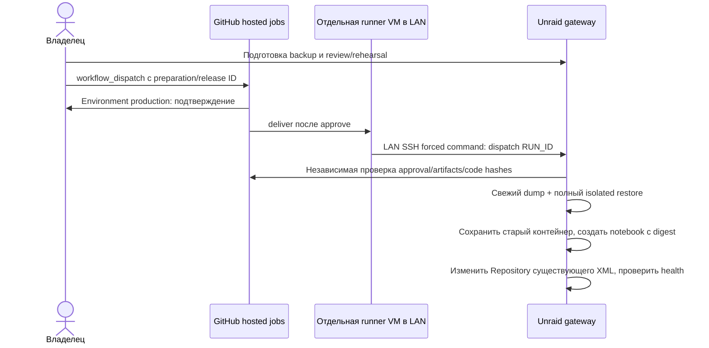

# Notebook: production deployment на Unraid

Реализация для Unraid **7.3.2** подготовлена, но **не установлена и не включена**. До стендовых
тестов и отдельного разрешения владельца production не обновлять. Push/release не запускают deploy.

## Архитектура и анализ рисков



Выбрана **отдельная Linux x64 VM с non-root self-hosted runner и ограниченным LAN SSH**.
На VM нет Docker/socket, sudo, production mounts, паролей БД, ключа приложения или GitHub read token
сервера. Deliver не делает checkout и не скачивает код: только root-owned локальный launcher.
На Unraid работает заранее проверенный локальный Python gateway. Он принимает только
`dispatch RUN_ID`, сам проверяет approval, pins, private review и одноразовый ledger.
User Scripts может вручную запускать подготовку; **он не принимает события GitHub**.
Compose не используется. SSH/Docker API не открываются в интернет; Docker — только Unix socket.

[GitHub предупреждает о компрометации self-hosted runners в публичных репозиториях](https://docs.github.com/en/actions/reference/security/secure-use).
Labels/`if` не security boundary. Выделить runner только этому workflow/main через runner group
restrictions, если доступны; не использовать в PR/build jobs. Защитить main/workflows review/ruleset.
Firewall VM: исходящие GitHub HTTPS, DNS/NTP и SSH к одному Unraid, без доступа к БД/остальной LAN/
admin UI. Предпочтительна одноразовая VM/ephemeral runner с пересозданием VM после job.
Кража SSH-ключа не разрешает shell или неподтверждённый deploy: проверки выполняются на Unraid.
Компрометация GitHub admin/reviewer или root Unraid остаётся за этой границей. Runner не размещать
на самом Unraid, в privileged-контейнере или рядом с Docker socket.

## Точная конфигурация

| Параметр | Значение |
| --- | --- |
| App | `notebook`, сейчас `ghcr.io/imnoname25/notebook:latest` |
| Target | `ghcr.io/imnoname25/notebook@sha256:<64 hex>` |
| Network / port | `notebook-net`, host `3100` → container `3000` |
| App XML | `/boot/config/plugins/dockerMan/templates-user/my-notebook.xml` |
| PostgreSQL | `notebook-postgres`, `postgres:17-alpine`, database/role `notebook` |
| PG mount | `/mnt/user/appdata/note/postgres` → `/var/lib/postgresql/data` |
| PG XML | `/boot/config/plugins/dockerMan/templates-user/my-notebook-postgres.xml` |
| Uploads | `/mnt/user/appdata/note/uploads` → `/data/uploads` |
| Backups | `/mnt/user/appdata/note/backup` → `/data/backups` |
| Env | `APP_ORIGIN=http://192.168.110.11:3100`, `TZ=Asia/Yekaterinburg`, `PUID=99`, `PGID=100`, `UMASK=002` |

Сохраняются **весь Env**, неизменные `DATABASE_URL`/`SETTINGS_ENCRYPTION_KEY`, Config/HostConfig,
mounts, user, entrypoint/cmd, healthcheck, labels, IP/ports, restart, capabilities/limits,
network aliases/static IP. Используется [официальный Engine API](https://docs.docker.com/reference/api/engine/)
(>=1.43, version определяется), не недокументированный Unraid PHP endpoint. Полный fingerprint
проверяется **до первого старта** кандидата. Исключены только image reference и generated ID aliases;
непереносимый параметр блокирует запуск. В текущем XML атомарно меняются только байты Repository.
WebGUI продолжает управлять именем `notebook` и тем же XML. PostgreSQL не останавливается и не пересоздаётся.

Не импортировать generic `unraid/notebook.xml`: defaults новых установок отличаются от production.
На время транзакции запретить GUI Edit/Update/Start, другие writers и сторонние auto-updaters:
flock не блокирует GUI. Отключить внешнее автообновление Notebook. Строгое сохранение Config может
оставить informational `NOTEBOOK_VERSION`/`NOTEBOOK_GIT_SHA` и labels от прежнего контейнера;
фактический image проверяется по digest и OCI revision **образа**. Новый image запускает существующий
entrypoint с `prisma migrate deploy`; SQL проверяется до старта.

## Первоначальная настройка — после отдельного разрешения

1. Уточнить **IP отдельной VM, actual LAN SSH port, host key fingerprint Unraid**, reviewer,
   поддержку required reviewers и место rehearsal. Эти данные не предоставлены. Host key сверить
   через доверенную консоль, одного `ssh-keyscan` недостаточно.
2. На Unraid проверить Python **>=3.11** по `/usr/bin/python3`, CA/HTTPS GitHub/GHCR, Docker CLI/socket,
   место под два dump/два uploads archive/развёрнутую БД с запасом. Python не считать стандартной
   частью Unraid: доступность после reboot обеспечивает администратор. Только Python stdlib.
   Preflight требует свободное место минимум `3 × pg_database_size + 2 × uploads size + 1 GiB`;
   это консервативный резерв, а не гарантия при росте данных. Старые копии не удаляются для освобождения места.
3. Создать root:root **0700** `/mnt/user/appdata/notebook-deploy-control` и `lib`, вне app mounts.
   Скопировать проверенные `unraid/{approval,deploy_core,deploy,engine,executor,verification,gateway,gateway_entry}.py`
   в `lib`, root-owned, не writable другим. `forced-command.sh` → control directory, mode 0700.
   Никакого автоматического git pull/root execution workflow кода.
4. `deployment.example.json` → control directory `deployment.local.json`, root 0600. Параметры
   заполнены, **`execution_enabled: false` оставить**. `postgres_socket: null` читает фактический
   `unix_socket_directories` через `postgres -C` стандартного контейнера. Custom command/multiple
   sockets требуют явно проверенного пути. Backup использует Unix socket/`--no-password`, не меняет
   auth/пароли. Если dump запрещён, процесс блокируется: нужны фактические socket/auth rules и
   права существующей роли, а не предположение о trust.
5. Fine-grained PAT **только на Unraid**: control directory `github-token`, root 0600, только repo
   `imnoname25/notebook`, **Actions read, Contents read, Metadata read**, без write/admin, с expiry/
   rotation. Read permissions соответствуют [Environment API](https://docs.github.com/en/rest/deployments/environments#get-an-environment)
   и [approval API](https://docs.github.com/en/rest/actions/workflow-runs#get-the-review-history-for-a-workflow-run).
   Private GHCR требует отдельный local root read-only Docker login; public image — нет.
   Tokens не помещать в CLI args/User Scripts output/repo/artifacts.
6. Заполнить `trusted_control_hashes` SHA-256 **проверенных исходных байтов**, ключи точно:
   `.github/workflows/unraid-production-approval.yml`, `unraid/approval.py`, `unraid/deploy_core.py`.
   Значения — 64 lowercase hex. Gateway сверяет Contents API на head_sha approved run. Изменение
   этих файлов требует нового локального review/pins; будущий workflow не получает root execution
   автоматически. Установленные модули обновлять только вручную после review.
7. На VM создать отдельный Ed25519 key. Secret key 0600 только service user runner, родительский
   каталог root-owned, не writable runner. `runner-dispatch.sh` → root-owned 0755
   `/opt/notebook-deploy/dispatch`; `runner-ssh-config.example` → `/etc/notebook-deploy/ssh_config`,
   заменить actual SSH port. До замены config намеренно не работает. `known_hosts` заполнить после
   сверки host key, config/known_hosts root-owned 0644. Никакого agent forwarding.
8. В persistent authorized_keys Unraid добавить public key (подставить actual IP VM):

   ```text
   from="<VM_PRIVATE_IP>",restrict,command="/mnt/user/appdata/notebook-deploy-control/forced-command.sh" ssh-ed25519 <PUBLIC_KEY> notebook-deploy
   ```

   Проверить [OpenSSH restrict/forced command](https://man.openbsd.org/sshd.8#AUTHORIZED_KEYS_FILE_FORMAT),
   root forced commands и persistence authorized_keys после reboot Unraid. Не ослаблять global
   root/password policy; если путь запрещён, нужен отдельно согласованный adapter. Ключу запрещены
   shell/scp/SFTP/PTY/forwarding. Firewall принимает SSH только с VM, WAN не открывать.
9. Зарегистрировать non-root runner с labels `self-hosted,linux,x64,notebook-production`, изолировать
   как выше. Registration token не хранить в repo. User Scripts — только ручная локальная подготовка,
   без расписания/webhook handler.
10. Создать Environment **`production`**, branch `main`, required reviewers — конкретные User.
    Проверить approval API тестовым запуском. Запретить self-review, если есть другой reviewer;
    единственный владелец выбирает применимую политику. Без bypass. Если reviewers недоступны по
    тарифу, workflow **блокируется**; Run не заменяет approval. До согласования другого подтверждения
    остаётся локальное ручное обслуживание.

## GitHub Secrets / Variables

| Тип | Имя | Назначение |
| --- | --- | --- |
| Repository Variable | `UNRAID_DEPLOY_ENABLED` | Только true включает manual workflow, по умолчанию unset/false |
| Environment | `production` | Individual reviewers, branch main |
| Новые Actions Secrets | **Нет** | SSH key только на VM, read token только на Unraid |
| Hosted jobs | Автоматический GITHUB_TOKEN | Contents/Actions read; deliver permissions пустые |
| Local profile | `execution_enabled` | Независимый host-side switch, по умолчанию false |

DATABASE_URL, SETTINGS_ENCRYPTION_KEY, PG credentials в GitHub не передавать. Android signing
secrets и существующие GHCR publishing settings сохраняются.

## Подготовка и миграции

1. Выбрать успешный **tag push** run существующего `docker-publish.yml` для `vX.Y.Z`.
   `notebook-image-<sourceSHA>/image.json` содержит digest/version/source SHA/migration checksums.
   Проверить source/release и CI checks; новый release создаётся только отдельной командой.
2. В maintenance window без GUI updates/DB writers выполнить локально
   `python3 /.../lib/deploy.py --config /.../deployment.local.json preflight`. Печатаются только
   допустимые текущие RepoDigests. Прежний digest брать из **текущего image ID**, не разрешать latest
   заново в registry — tag мог переместиться. Сохранить manifest в private local staging.
3. Из доверенной консоли/User Scripts выполнить:

   ```sh
   /usr/bin/python3 /mnt/user/appdata/notebook-deploy-control/lib/gateway.py prepare-review \
     --manifest /PRIVATE_STAGING/image.json \
     --previous-image ghcr.io/imnoname25/notebook@sha256:PREVIOUS_DIGEST
   ```

   Notebook останавливается только на время consistent backup и возобновляется прежним образом
   для review (проверить healthy после возобновления). PG не останавливается. Проверяются Prisma
   chain/checksums, unresolved migrations и другие DB clients. Dump проходит `pg_restore --list`
   и **полный restore** в новый verifier того же local PG image ID, без сети/портов/production
   mounts/secrets. Сравнивается history; uploads archive читается целиком, сохраняются hashes.
   Dump/restore failure запрещает update.
4. ID указывает `/mnt/user/appdata/note/backup/deployments/<ID>`, root 0700/files 0600. Dump/uploads/
   XML/state приватны. Удаляется только собственный verifier по UUID+label; **его private bind data
   сохраняется**. App/PG контейнеры, volumes и пользовательские данные не удаляются.
5. Проверить **каждый SQL migration**. Prefix/checksum не доказывают SQL safety. На отдельном стенде
   с dump/uploads и ограниченной сетью выполнить candidate upgrade, проверить данные/login/uploads,
   затем прежнее приложение на новой схеме/новых записях. DROP/rename/type change/data rewrite
   требуют особого анализа. Несовместимый rollback — отдельный DBA/restore plan с учётом потери новых
   записей; этот механизм для него не подтверждать.
6. После реальных rehearsal скопировать `review.example.json` → `review.json` в том же private
   directory, сохранить hashes, выставить три флага true. Это **ручное удостоверение**, не SQL proof.
   Сохранить закрытый отчёт стенда, посчитать SHA-256 review локально, XML/inspect/dump не печатать.
   Для deploy snapshot действителен 24 часа. Execution делает новый backup; SQL review должен учитывать
   новые данные, initial rehearsal не является проверкой будущего snapshot.

## Обновление

Только после стендовых сценариев и отдельного разрешения включить local `execution_enabled: true`
и Repository Variable `UNRAID_DEPLOY_ENABLED=true`; до этого оставить выключенными.

1. Actions → **Deploy Notebook to Unraid (manual)** → Run на main: `operation=deploy`,
   `preparation_id=<ID>`, `publish_run_id=<stable Docker run ID>`, `previous_image=<прежний digest>`,
   `review_sha256=<review hash>`. Проверить значения, подтвердить Environment production.
2. Hosted jobs проверяют build/protection; artifact — только публичная заявка. VM передаёт run ID.
   Gateway проверяет workflow/main/current attempt/approve job/recorded User review/control hashes,
   возраст approval<=24h, manifest/review/pair/backup hashes. O_EXCL ledger потребляет ID **до любых
   изменений**. Ошибка требует нового dispatch/approval; rerun прежнего ID запрещён.
3. Pull digest, OCI source revision, healthy source/config/PG guard. Остановка Notebook, **свежий
   dump + полный isolated restore + uploads backup**, проверка schema/config drift. До successful
   backup новый контейнер не создаётся; при backup failure прежний образ возобновляется.
4. Сохранить private Config snapshot; старый stopped контейнер → `notebook-retained-<transactionID>`,
   restart off/network disconnected. Создать новый **notebook** с исходными настройками + digest,
   fingerprint проверить **до старта**. Изменить Repository текущего XML, запустить; новая версия
   получает исходную restart policy, persistent mounts и все Env.
5. До 180 секунд ждать Docker healthy и HTTP 200 `/api/health/ready` LAN origin без redirects/proxy.
   Проверить image/config/XML и PG ID/config/template, сохранить `success.json`. Старые containers/
   images/backups остаются. **Не запускать retained containers** — те же persistent данные. Cleanup
   возможен только отдельным решением владельца, автоматически не выполняется.

## Ошибки и откат

В GitHub — только фиксированные коды/transaction ID. Private receipts: `failure-*.json`,
`replacement-started.json`, `approval-source.json`, `success.json`, `automatic-rollback.json`.
**container-private.json и XML содержат секреты**: только root, не artifacts/support. Raw Docker/
SQL errors подавляются. Не публиковать raw inspect/logs/XML/SQL/exception text.

При ошибке кандидат stopped → `notebook-failed-<transactionID>`, restart off/network off. При history,
строго равной fresh snapshot, без unresolved migrations создаётся прежний digest с исходными
настройками, исправляется Repository, проверяется health. Workflow всё равно ошибочный; повторного
update нет. При изменённой/частичной схеме прежнее приложение **не стартует**. Image rollback не
является DB rollback. Автоматического production restore нет.

Поздний откат: **новый** workflow `operation=rollback`, исходные preparation/build ID, previous
digest/review hash. Новое Environment approval, свежий verified backup; вернуть прежнее приложение
можно только при history, равной исходной **до update**, без unresolved migrations. Release с новыми
применёнными migrations этим путём откатить нельзя даже при предположении совместимости SQL:
более широкий rollback требует отдельно согласованного восстановления.

При SSH/process interruption/reboot или recovery failure автоматически не повторять. Проверить
private journal/IDs локально, остановить других writers, убедиться, что запущен максимум один
Notebook. Сохранить текущую БД/uploads. Без schema change восстановить приложение через Unraid GUI
по private snapshot/прежнему digest/XML с healthcheck. Retained container имеет выключенные network/
restart — простого Start недостаточно. При schema change DBA проверяет restore отдельно и согласует
точку/потерю новых записей. PG не пересоздавать, volumes не удалять, secrets не заменять. Обрыв Engine
create может оставить stopped container: разбирать по ID/journal, не rm/prune.

## Проверки и условие включения

Docker CI запускает `python -m unittest discover -s unraid -p 'test_*.py'` до публикации. Unit/mock
tests покрывают digest/approval/pins/replay, backup failure, drift до старта, health failure,
settings preservation/rollback/schema-change denial. Они не заменяют Docker/Unraid integration.

На отдельном стенде проверить реальный sanitised settings snapshot (static IP/aliases/extra params/
limits/restart), update, dump/restore failure, registry failure, config/XML drift, health timeout,
no-migration rollback, rollback denial после полной/частичной migration, invalid/replayed/expired
approval, отсутствующий Environment review, SSH/process interruption и reboot на границах handoff.
Проверить fsync/atomic replace на реальном /boot, PG ID/template/mounts и secret fingerprints без
вывода значений. До прохождения этих сценариев production switches остаются выключенными.
